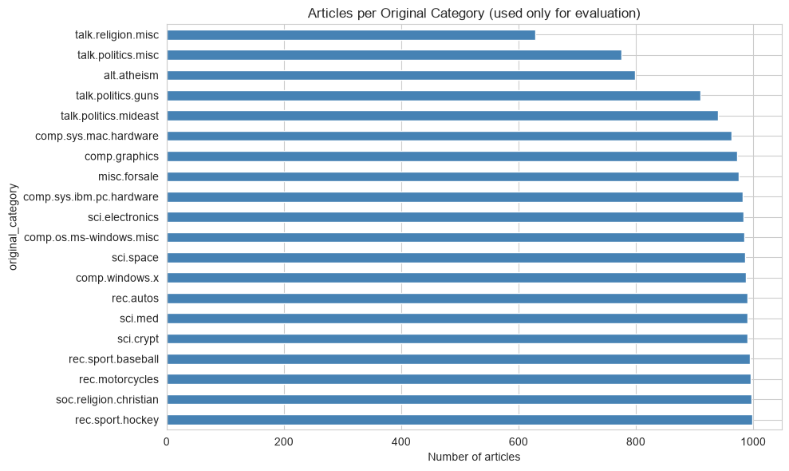
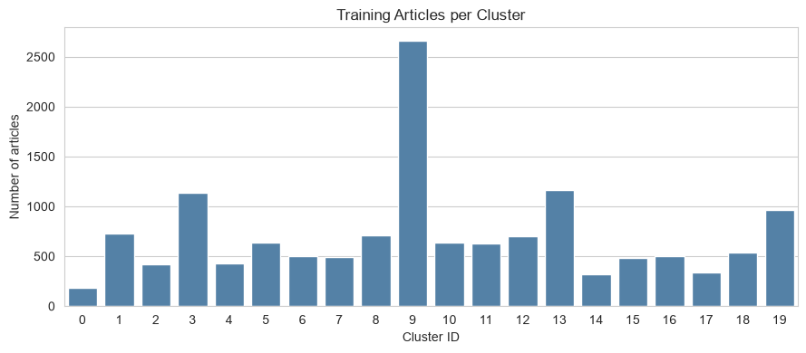
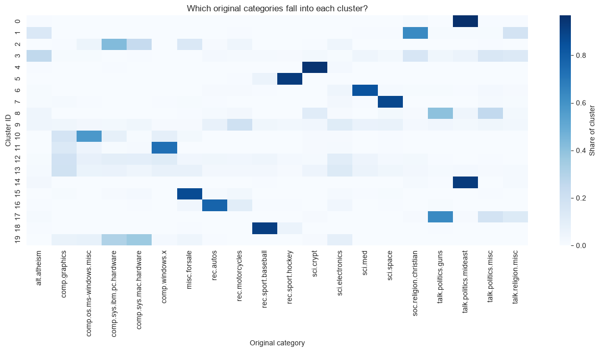
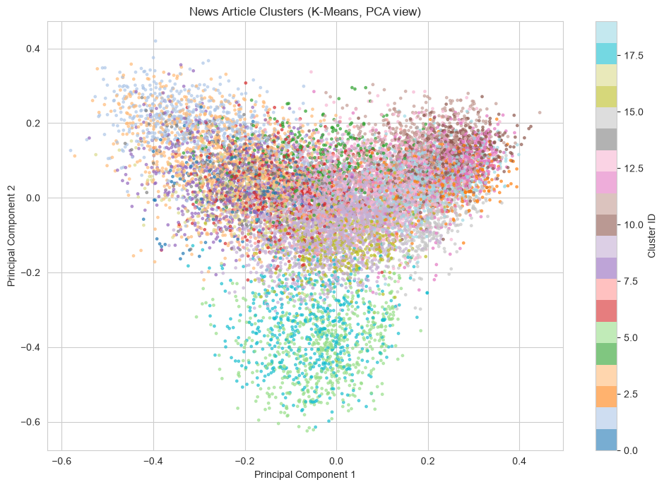
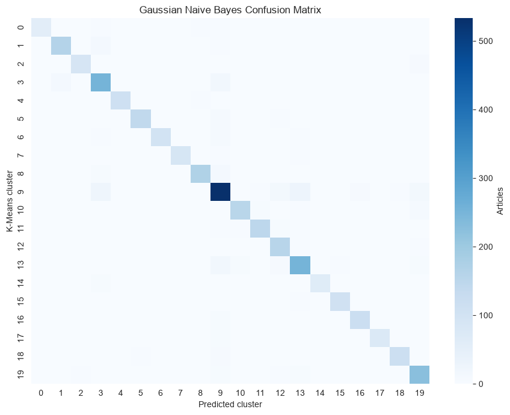

# 📰 News Topic Discovery Using K-Means Clustering


**An end-to-end NLP experiment that discovers groups of related news articles using TF-IDF, SVD/Latent Semantic Analysis (LSA), normalized features, and K-Means clustering.** The notebook then interprets the resulting clusters and uses Gaussian Naive Bayes as an additional check for predicting K-Means cluster assignments.

> **Project goal:** explore how news articles can be grouped by their text when topic labels are not used to fit the K-Means model.

## ✨ Project at a glance

| Item | Details |
|---|---|
| Dataset | 20 Newsgroups, loaded using scikit-learn |
| Articles loaded | 18,846 |
| Articles after cleaning and deduplication | 17,705 |
| Train / test split | 14,164 / 3,541 (80% / 20%) |
| Text features | TF-IDF, up to 20,000 unigram and bigram features |
| Dimensionality reduction | Truncated SVD / LSA |
| Selected representation | 100 SVD dimensions, L2-normalized |
| Clustering algorithm | K-Means, 20 clusters |
| Additional model | Gaussian Naive Bayes for predicting discovered cluster IDs |

## 🔄 Workflow

```text
20 Newsgroups dataset
        ↓
Remove headers, footers and quoted replies
        ↓
Clean text + remove short/duplicate articles
        ↓
Train/test split
        ↓
TF-IDF vectorization (unigrams + bigrams)
        ↓
Truncated SVD / Latent Semantic Analysis
        ↓
Normalize article vectors
        ↓
Compare candidate dimensions and cluster counts
        ↓
K-Means clustering
        ↓
Evaluate + inspect keywords, sample articles and visualizations
        ↓
Gaussian Naive Bayes check on K-Means cluster assignments
        ↓
Paste a new article to inspect its assigned cluster
```

## 🧰 Techniques used

- **Text preprocessing:** lowercasing, removing email addresses and URLs, keeping letters, and removing very short or duplicate cleaned articles.
- **TF-IDF:** transforms article text into numeric features; uses English stop words, sublinear term frequency, unigrams and bigrams, and a maximum of 20,000 features.
- **SVD / LSA:** reduces the sparse text matrix to a dense representation. Candidate dimensionalities of 100, 200 and 300 are compared.
- **Normalization:** scales each reduced article vector to length 1 before K-Means.
- **K-Means:** candidate cluster counts of 10, 15, 20, 25 and 30 are compared; the selected setting in this run is 20 clusters with 100 SVD dimensions.
- **Interpretation:** extract high-weight terms for each cluster, inspect sample articles, compare cluster composition with original categories, and visualize the groups with PCA.
- **Gaussian Naive Bayes:** trained on training-set reduced features with K-Means cluster IDs as targets, then compared with K-Means assignments for test articles.

## 📊 Results from the notebook

### Final K-Means evaluation

| Metric | Training set | Test set |
|---|---:|---:|
| Silhouette score | 0.0579 | 0.0569 |
| Adjusted Rand Index (ARI) | 0.2349 | 0.2263 |
| Normalized Mutual Information (NMI) | 0.4625 | 0.4555 |

The test scores are close to the training scores in this run. The low silhouette score indicates that cluster separation in this representation is modest; ARI and NMI measure agreement between the discovered clusters and the original 20 categories. These are **clustering evaluation metrics, not classification accuracy**.

### Gaussian Naive Bayes cluster-prediction check

The notebook reports **0.8848 (88.48%) agreement accuracy** when Gaussian Naive Bayes predictions are compared with the K-Means-generated test cluster IDs.

This result answers: *how well can Gaussian Naive Bayes predict the cluster IDs assigned by K-Means?* It does **not** mean that 88.48% of articles were assigned to the correct original news category.

### Visual results

#### Original category distribution



#### Candidate/selected cluster sizes



#### Cluster composition compared with original categories



#### PCA view of the K-Means clusters



#### Gaussian Naive Bayes cluster-prediction confusion matrix



## 🚀 Run the project locally

### 1. Clone this repository

```bash
git clone https://github.com/YOUR-USERNAME/news-topic-discovery-kmeans.git
cd news-topic-discovery-kmeans
```

Replace `YOUR-USERNAME` with your GitHub username after you create the repository.

### 2. Create a virtual environment (recommended)

```bash
python -m venv .venv
```

Activate it:

- **Windows PowerShell:** `.venv\Scripts\Activate.ps1`
- **Windows Command Prompt:** `.venv\Scripts\activate.bat`
- **macOS / Linux:** `source .venv/bin/activate`

### 3. Install the packages

```bash
pip install -r requirements.txt
```

### 4. Launch Jupyter

```bash
jupyter notebook
```

Open `notebooks/news_topic_discovery.ipynb` and run the cells in order. The first dataset download may require an internet connection; scikit-learn handles loading and caching the dataset.

At the end of the notebook, run the interactive input cell separately and paste a news article to see its assigned cluster, likely category mapping, and top cluster keywords.

## 📁 Repository structure

```text
news-topic-discovery-kmeans/
├── README.md
├── requirements.txt
├── .gitignore
├── notebooks/
│   └── news_topic_discovery.ipynb
└── assets/
    ├── original_category_distribution.png
    ├── svd_explained_variance.png
    ├── cluster_distribution.png
    ├── cluster_category_heatmap.png
    ├── pca_cluster_visualization.png
    └── gaussian_nb_confusion_matrix.png
```

## ⚠️ Evaluation notes and limitations

- K-Means is fitted on text-derived features without using the original category labels as fitting targets.
- **The original labels are used during candidate-setting selection** through ARI/NMI, and in the notebook's cluster-to-category interpretation. Therefore, while the clustering fit is unsupervised, the overall parameter-selection and naming workflow is not fully label-free.
- Cluster IDs such as `0`, `1`, and `2` are arbitrary identifiers, not meaningful topic names by themselves.
- News topics can share vocabulary, and short/noisy posts make clustering difficult. The PCA plot is only a 2D projection for visualization; overlap in the plot does not on its own determine performance.
- Gaussian Naive Bayes is evaluated against K-Means cluster IDs, not against the true 20-category target. Its score should be interpreted accordingly.
- Results can vary with preprocessing, vectorization, SVD dimensionality, cluster count, and random initialization.

## 🗂 Dataset

The notebook uses scikit-learn's `fetch_20newsgroups()` loader and removes headers, footers, and quoted replies when loading the articles. The dataset is fetched by the loader rather than included as a separate data file in this repository.

## 👥 Contributors

Add the team members' preferred names and GitHub profile links here before publishing.

## 📄 License

No license file is included in this starter package. If the team agrees to allow reuse of the project's code, the **MIT License** is a common permissive option. Confirm that all contributors agree and add the license text and appropriate copyright notice before selecting it on GitHub.

---

**Built as a Machine Learning Laboratory project** — exploring practical text preprocessing, unsupervised clustering, topic interpretation, and model evaluation with Python.
